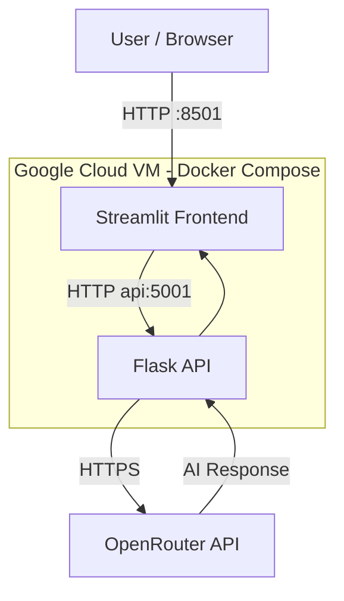

# DT1 2026 – Assignment 1: Enabling Technologies

## Application

A simple AI chat application using **Streamlit** as the frontend and **Flask** as an API proxy to communicate with **OpenRouter**.

The application is containerized using Docker Compose and deployed on a Google Cloud VM (Debian 13, e2-micro).

## Architecture

- **Streamlit (Port 8501):** User interface for submitting prompts and displaying AI responses.
- **Flask (Port 5001):** Internal API proxy handling requests to OpenRouter.
- **OpenRouter:** External service providing access to the AI model.
- **Docker Compose:** Manages both containers and their internal communication.
- **Google Cloud:** Hosts the application on a virtual machine.

## Security Improvements

- **API Key Protection:** The OpenRouter API key is stored in a server-side `.env` file and accessed only by Flask. It is no longer transmitted through frontend requests.
- **Environment Isolation:** `.env` is excluded from Git and Docker build contexts.
- **Network Security:** Only Streamlit (port 8501) is exposed. Flask (port 5001) remains accessible exclusively within the Docker network.
- **Firewall Restrictions:** Google Cloud allows incoming connections on port 8501 only from the BFH IP range (`147.87.0.0/16`).
- **Debugging:** Flask debug mode and API-key logging have been disabled.

## Deployment

The application has been successfully deployed and tested on Google Cloud using Docker Compose.

**Application URL:** http://35.246.141.194:8501

Access is restricted to the BFH network. Internal functionality and AI responses have been verified; external access from the BFH network has not yet been independently tested.
